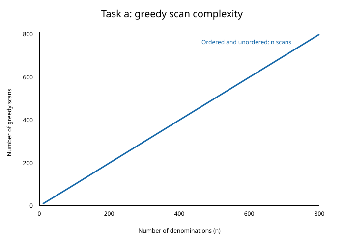
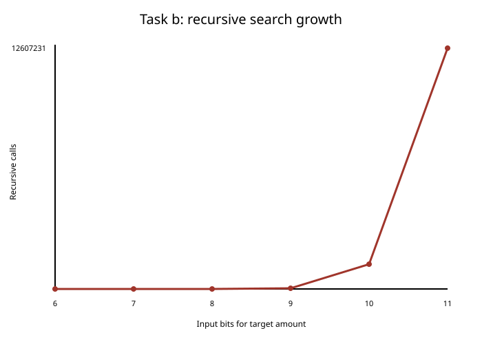

# Make Change - Exact Solving in C++

**Authors: Ahmed Al-Muharaq and Owais Ahmed Khan**

Mobility in Smart Cities practical work

This project studies the **Make Change** problem: given a target amount and a set of coin denominations, find non-negative coin counts whose weighted sum is exactly the target. It progresses from a fast greedy heuristic to exhaustive enumeration, exact minimization, branch-and-bound, finite coin stocks, diverse alternatives, and tabu-based exclusion.

The program's worked instance is **EUR 12.35**, represented as `1235` integer cents, with denominations:

```text
500, 200, 100, 50, 20, 10, 5 cents
```

All calculations use integers. This avoids floating-point rounding in equality, division, and remainder operations.

## Implemented tasks

### A. Ordered and shuffled greedy search

The greedy pass takes as many coins as possible at each denomination, then continues with the remainder. It is run once with descending denominations and once with a reproducible shuffled order (seed `42`). Each version scans all `n` denominations, so the selection loop is linear: `Theta(n)`. The shuffle itself is also linear.

The result depends on denomination order. For EUR 12.35, the ordered pass uses 6 coins, while the shuffled pass uses 64. Greedy is a heuristic: descending order is not guaranteed to minimize the number of coins for an arbitrary denomination system, and it may fail to find an exact solution even when one exists.



### B. Recursive and iterative enumeration

Two exhaustive depth-first searches generate every valid count vector:

- The recursive method assigns a count to each denomination and backtracks.
- The iterative method reproduces the same traversal with an explicit stack of `(index, remaining, next count)` frames.

Both methods stream solutions to CSV instead of keeping all vectors in memory. For the worked instance they each produce 266,724 solutions, in the same order.



### C. Minimum coin count and branch-and-bound

This search minimizes the total number of coins. Counts are explored in increasing order so that each strictly better incumbent can be recorded. The program compares:

- an unpruned exhaustive search; and
- a branch-and-bound search using the optimistic lower bound `used + ceil(remaining / largest_available_coin)`.

A branch is cut when that bound cannot improve the incumbent. Both variants retain the same six-coin optimum and the same sequence of 242 improvements, but the cut reduces recursive calls from 12,607,231 to 20,936 on the worked instance.

### D. Heterogeneous coin limits

The exact search accepts a separate stock limit for every denomination. The example limits, in descending denomination order, are:

```text
1, 2, 5, 10, 10, 10, 10
```

The program applies these limits during branching and uses the same safe lower-bound cut. The constrained optimum for EUR 12.35 uses 9 coins. A zero-stock check also confirms that no positive target is feasible when every limit is zero.

### E. Three pairwise-diverse solutions

The solver returns three constrained solutions sequentially. A new vector must have Manhattan (L1) distance of at least `4` from every previously selected vector:

```text
distance(x, y) = sum(abs(x[i] - y[i]))
```

Each selected solution is the cheapest one that satisfies the constraints imposed by the earlier choices. The resulting costs are 9, 11, and 11 coins. This sequential rule does not claim to optimize the three-solution set as a whole.

### F. Successive best solutions with a tabu set

After each constrained optimum is returned, its complete count vector is inserted into an explicit tabu set. The next exact search excludes every vector in that set. This forbids exact repeats without imposing Task E's distance threshold. The first three non-tabu solution costs are 9, 10, and 10 coins.

## Confirmed EUR 12.35 results

| Measurement | Result |
|---|---:|
| Ordered greedy | 6 coins |
| Shuffled greedy | 64 coins |
| Recursive enumeration | 266,724 solutions |
| Iterative enumeration | 266,724 solutions |
| Task C without cut | 12,607,231 calls; optimum 6 |
| Task C with cut | 20,936 calls; optimum 6 |
| Task D constrained optimum | 9 coins |
| Task E diverse costs | 9 / 11 / 11 |
| Task F non-tabu costs | 9 / 10 / 10 |

These values were reproduced from the current source. Measured execution times are intentionally not fixed here because they vary by computer, compiler, optimization level, storage speed, and system load.

## Project structure

```text
.
|-- main.cpp
|-- make_money.pdf
|-- task_a_complexity.csv
|-- task_a_curve.svg
|-- task_b_complexity.csv
|-- task_b_curve.svg
|-- task_c_improvements_no_cut.csv
|-- task_c_improvements_with_cut.csv
|-- .gitignore
`-- README.md
```

`main.cpp` contains all six tasks. `make_money.pdf` is the full report. The small CSV files contain benchmark data and Task C's incumbent traces; the SVG files are the corresponding curves.

## Build and run on PowerShell

Requirements:

- Windows PowerShell or PowerShell 7;
- a C++17 compiler;
- MSYS2 UCRT64 g++ at `C:\msys64\ucrt64\bin\g++.exe` for the exact commands below.

From this repository's directory:

```powershell
& "C:\msys64\ucrt64\bin\g++.exe" -std=c++17 -O2 -Wall -Wextra .\main.cpp -o .\make_change.exe
.\make_change.exe
```

If `g++` is already on `PATH`, the equivalent build command is:

```powershell
g++ -std=c++17 -O2 -Wall -Wextra .\main.cpp -o .\make_change.exe
```

The executable writes these files into the current working directory, replacing files with the same names:

| Generated file | Contents |
|---|---|
| `task_a_complexity.csv` | Ordered and shuffled greedy scan counts |
| `task_a_curve.svg` | Task A scan-complexity curve |
| `task_b_solutions.csv` | All recursively enumerated solutions |
| `task_b_iterative_solutions.csv` | All iteratively enumerated solutions |
| `task_b_complexity.csv` | Task B count-only benchmark data |
| `task_b_curve.svg` | Task B recursive-call growth curve |
| `task_c_improvements_no_cut.csv` | Successive incumbents without pruning |
| `task_c_improvements_with_cut.csv` | Successive incumbents with pruning |

The two full Task B solution CSVs are about 4.6 MB each for the example input and are deliberately ignored by Git because they are reproducible generated data. The executable is also ignored.

## Curves and report

GitHub renders the Task A and Task B SVG figures embedded above. They can also be opened directly:

- [Task A greedy scan curve](task_a_curve.svg)
- [Task B recursive search curve](task_b_curve.svg)

The complete illustrated write-up is available as the [Make Change report](make_money.pdf). Most modern browsers and GitHub's file viewer can display the PDF; download it if the browser does not render it inline.

## Limitations

- Greedy change-making is not generally optimal for arbitrary denominations.
- Timings vary by machine and should be treated as observations, not portable performance guarantees.
- The EUR 12.35 results and generated checks do not prove correctness for every possible target, denomination list, stock limit, or diversity threshold.
- Inputs are currently defined in `main()`, so changing the scenario requires editing the source and recompiling.
- Exhaustive enumeration can generate very large output files and becomes impractical as the search space grows.
